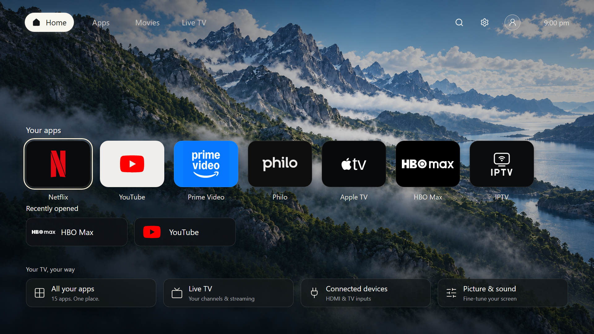
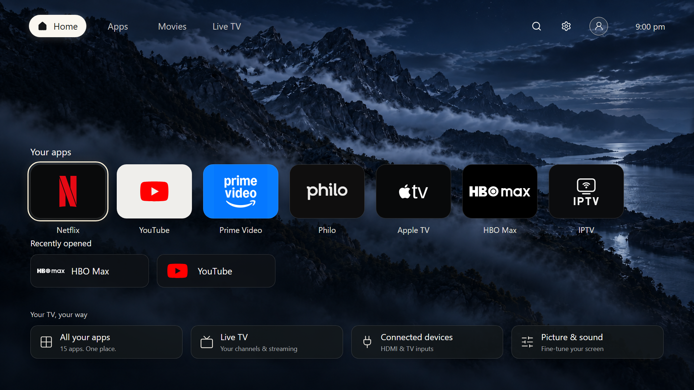

<!-- quiettv:public -->

# QuietTV

**Replace Samsung Home, remove unwanted Samsung software, and keep the TV features you use.**

**Verified TV: Samsung UN43U8000FBXZA · firmware 1300.8 · Tizen 9 · ARMv7.**
Other TVs and firmware are not verified or supported yet.

QuietTV is a replacement TV launcher with owner-authorized root and backend
cleanup. The launcher and cleanup below are already running on the test TV.

- **Adds:** our Home screen and startup experience, real app cards, remote
  navigation, day/dusk/night wallpapers, appearance options, and optional
  weather. Home returns to QuietTV; native apps still open normally.
- **Removes on the test TV:** **27 optional payload folders**, including
  Samsung analytics, targeted ads, Bixby/voice components, AI Companion,
  content-recognition components, Guide, the standalone TV Plus app and
  Security Center's information screen. These files and their quarantine
  copies are physically off the TV; disabled registry entries remain.
- **Also blocks:** selected remaining Samsung background services. Some
  read-only components are blocked rather than deleted. This is not proof
  that every tracking path is gone.
- **Keeps:** Tizen's OS and drivers, picture/sound settings, TV/HDMI sources,
  volume, core security, network, native streaming apps, Browser, and
  Store/update dependencies.
  Two shared packages are held until their dependencies are verified.
- **Measured storage reclaimed:** about **250 MiB**, excluding the separate
  analytics removal. RAM savings have not been measured.

See the [full removed/blocked/kept inventory](docs/CLEANUP-STATUS.md).
The public consumer installer and live restore tool are still being built;
there is no download-and-install release yet. The planned setup needs no AI
or subscription, with AI control available as an optional route.

[Install plan and upstream tools](docs/INSTALL-OPTIONS.md) ·
[Optional AI/MCP setup, remote control and screenshots](public-llm/README.md)

*Desktop renders of the current launcher at 1920×1080, using sample
recent-app history. They are not photos of a TV. App availability varies by
TV.*

## Compatibility

| TV model | Firmware | Status |
|---|---|---|
| Samsung UN43U8000FBXZA (ARMv7, Tizen 9) | 1300.8 | Verified on the test TV; public setup tools in development |
| Anything else | — | **Not supported.** QuietTV refuses other models and firmware. |

## Current status: verified on the test TV; public setup tools in development

- **The launcher works on the test TV.** On the Samsung UN43U8000FBXZA
  (Tizen 9, ARMv7, firmware 1300.8) the launcher (2.0.18) is installed. Home,
  the remote, native app launch, picture and sound settings, Settings, the
  input picker and opening the Store all passed, as did unattended root
  recovery.
- **No consumer self-installer yet.** There is no installer you can download
  today, and no live public restore writer. What is public so far is source
  and offline-tested building blocks (see the roadmap below).
- **Removed on the test TV:** a set of optional Samsung payloads, listed in
  [docs/CLEANUP-STATUS.md](docs/CLEANUP-STATUS.md) with what was kept and
  what was held back.
- **Not verified yet:** Store app updates actually installing, DRM playback
  and physical HDMI video. IPTV picture is currently black, so IPTV will be
  hidden or marked unavailable until fixed. A black gap on cold boot is still
  unsolved. Memory (RAM) savings have not been measured, and removing all
  Samsung tracking has not been proven.

## How installing will work (planned, not available yet)

1. Download **QuietTV Helper for Windows**. It checks its own signature, and
   you install no Python, coding tools or AI.
2. On the TV, use the remote to turn on **Developer Mode** and enter your
   PC's address. Developer Mode lets your PC talk to the TV. It does not
   change the TV by itself.
3. In the Helper, **back up** your TV to your PC, NAS or USB stick. Stock
   files are not removed and Home/startup is not changed until the backup
   has been read back and checked.
4. Choose root + launcher, then **Recommended cleanup** or items one by one.
   You see exactly what will change, then approve it.
5. Check Home, remote, Settings and inputs with your remote.

The current packaged-launcher route needs one Samsung sign-in for a signing
profile tied to your TV. The aim is to automate and reuse it through the Helper,
using existing installer work where possible—not make you manage certificates
by hand. [Samsung documents this requirement](https://developer.samsung.com/smarttv/develop/tools/additional-tools/vscode/creating-certificates.html).
Developer Mode and that certificate do not give
root access; root comes from a separate step built for your exact model and
firmware. Each owner gets their own keys, and nothing is shared.

**Type a URL into the TV browser?** That is the goal. The first planned
version uses the TV browser as a *screen* for the Helper on your PC, on the
same network. Whether a browser page can install root and QuietTV on stock
firmware by itself is **not yet proven or ruled out**, and we won't claim it
until it is shown working on a real TV. Opening a QuietTV page never changes
your TV by itself.

## Cleanup and restore (planned)

- Every item shows what it does, what depends on it, and whether it can be
  restored.
- Results are reported plainly: **removed**, **disabled**, **kept**,
  **held** (needed by something else, such as updates) or **failed**.
- **Restore individual** puts back one item. **Restore Samsung** is meant
  to undo QuietTV's changes, removing QuietTV itself last. It will only be
  offered once it has been proven on hardware.
- **Rescue** is a separate restore tool kept on your PC. It needs your home
  network to reach the TV, but not the internet, the QuietTV launcher or its installed control service. If the TV's firmware changes and Rescue's access method
  no longer works, Rescue tells you; it cannot promise to fix every failure.
- Removing something from the TV's own menu later needs a verified backup of
  that exact item, either already on your PC or reachable at that moment.
  Otherwise **Remove** is greyed out and tells you why. The launcher itself
  works without your PC switched on.
- Holding firmware auto-updates is a separate choice you opt into, with the
  trade-off explained. App updates stay on.

## Backups and privacy

Your backup stays **off the TV**, on storage you control (planned: encrypted
with your own passphrase). QuietTV never uploads your backup, account
details, certificates or serial numbers. We publish our own source, builds,
model profiles and checksums. We do not host Samsung firmware or Samsung
apps. Generic, exact-version components might be published later, but only
with verified permission, a clean scan and proven compatibility. A link to
Samsung's official firmware is not a restore guarantee.

## FAQ

**Is this a factory reset?** No. Factory reset, Reset Smart Hub, Samsung's
USB firmware update and QuietTV restore are different things. Samsung notes
that a full factory reset changes the TV's device ID, and nothing promises it
brings back removed files. QuietTV restore puts back what QuietTV changed,
from your own backup.

**Can I go back to older Samsung firmware?** [Samsung says firmware downgrade is not supported](https://developer.samsung.com/smarttv/develop/faq/device-information-and-firmware.html). QuietTV does not flash firmware.

**Does it stop all tracking?** We report which known Samsung services we
removed or turned off. That does not prove zero telemetry, and it does not
cover streaming apps you install.

**Will it make my TV faster?** We will publish measured storage and memory
numbers, with the method used. Until then we make no claim.

**My TV is a different model.** Not supported. QuietTV refuses rather than
guesses.

**What if my backup was made after other changes?** It is labelled a
"current-state" backup. It cannot restore anything removed before it was
taken.

## Installation roadmap

Read the [consumer install design](docs/CONSUMER-INSTALL-DESIGN-2026-10-27.md)
and the [phased implementation plan](docs/superpowers/plans/2026-10-27-consumer-install.md).
These describe planned work, not an installer available today.

Implementation is underway. A [TV browser setup-page test](public-toolkit/docs/D0-BROWSER-PROBE.md)
passed on the test TV. The [offline engine](public-toolkit/docs/D1-ENGINE.md)
and [backup readback gate](public-toolkit/docs/D2-READBACK.md) have automated
tests. A separate [Rescue engine](rescue/README.md) is also tested offline.
These foundations do not yet install or restore a consumer TV.

Developers can also build the [portable TV-side native host](launcher/host/README.md).
Its temporary on-TV self-test passed; it is not a replacement installation
or a complete launcher package.

The [owner configuration generator and preview widget builder](launcher/widget/README.md)
now produce an ordinary, separate TV app from the sanitized frontend and an
owner's selected installed apps. A privately signed preview was installed
and rendered on the test TV: Right moved focus and selecting YouTube opened
YouTube. Home returned to the existing launcher; the preview was then
uninstalled. This was a warm test, not a stock installation. The public builder
produces an **unsigned** package; it does not root the TV, register Home or
enable startup. Owner keys and signed packages are not published.

The [recovery/2 format](public-toolkit/docs/RECOVERY2.md) validates exact
device facts, approved external file references and individual startup
fields. Its offline undo planner refuses changed values rather than
overwriting them. There is still no live recovery/2 writer or complete
consumer installer.

The [local Helper preview](helper/README.md) now has a working **Check TV**
page. It recognises the test TV and reports the missing compatibility checks;
install, cleanup and restore remain unavailable. The separate
[read-only inventory tool](tools/tv-inspect/README.md) was warm-tested on the
TV and correctly detects leftover registry entries. It exits after each read.
Neither is a consumer Windows installer or a live backup/restore connection yet.

What was removed on the test TV, and what was deliberately kept or held, is in
[docs/CLEANUP-STATUS.md](docs/CLEANUP-STATUS.md).

## Contributing

Fork, open a pull request, let the offline checks run, and wait for review.
Hardware claims need evidence at the exact commit. See
[public-llm/community/CONTRIBUTING.md](public-llm/community/CONTRIBUTING.md).

## Licence

No repository-wide licence has been chosen yet; the owner is deciding. Component licences are in
[THIRD-PARTY-NOTICES.md](THIRD-PARTY-NOTICES.md).

## For developers using AI assistants (optional)

You never need AI for install, use or restore. If you want to drive a test
TV from an AI client, see the optional MCP package in
[public-llm/README.md](public-llm/README.md). Models may refuse device
work; the plain command line is always available.
